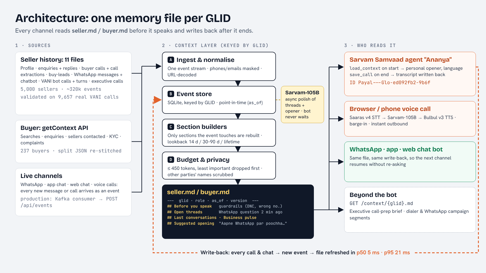

# Global Context — VANI knows the user before it speaks

**Voice AI Hackathon 2.0 · Problem 2: Global Context — Memory Across Channels**



A GLID-keyed memory layer that turns everything a seller or buyer has done on IndiaMART — enquiries, buyer
calls, buy-leads, WhatsApp chats, past VANI calls, executive calls — into a short, structured, always-fresh
`seller.md` / `buyer.md`. VANI loads it before every call or chat, opens with a personal line, and picks up
the conversation where the last channel left it. Every conversation writes back to the same file.

```
WhatsApp ─┐                         ┌─► VANI voice call (Sarvam Bulbul + Saaras + Sarvam-105B)
Enquiries ─┤   events ─► Context   ─┤─► WhatsApp bot
PNS calls ─┼─► store  ─► engine ───►├─► Sales-executive brief / CRM / any service (GET /context/{glid}.md)
Buy-leads ─┤  (SQLite)  (sections, └─► Sarvam Voice Agent (on_start / on_end HTTPS tools)
VANI/Exec ─┘            budget, LLM)        ▲
            ◄──────── call outcome written back ┘
```

## Results on the real hackathon data

| What | Result |
|---|---|
| Files generated | 5,000 `seller.md` + 237 `buyer.md`, **100% schema-valid** |
| Size | median **269 tokens** (seller), **173 tokens** (buyer), hard cap 450 |
| Compression | buyer: **12×** smaller than the raw `getContext` JSON |
| Freshness (replay of 3,000 real events) | event → updated file **p50 6 ms, p95 27 ms** (laptop, SQLite) |
| Correctness | incremental refresh **100% identical** to a full rebuild |
| Resumed without re-asking (60 WhatsApp → voice scenarios) | rule-based bot: memory on **100% pick up the thread, 0% re-ask** vs off 3% / 20% · **real Sarvam-105B + LLM judge (2 runs, 120 calls each): memory on 96.7% pick up the thread, 1.7–5.0% re-ask** vs off 20–32% / 20–23% |
| Privacy | **0 of 5,237 files** quote another party's name (checked against 22,090 buyer names) · 0 phone numbers / emails |
| Cold start | unknown GLIDs get a clean generic file and opener; their first message turns it warm |
| Reuse beyond the bot | executive call-prep brief (`/brief/{glid}`) + WhatsApp-campaign segments (`/api/segments`) read the same files |
| Full rebuild | 5,000 sellers in **13 s** (2.6 ms/seller) |
| Calls that started cold despite fresh activity on another channel | **26.7%** of 9,657 VANI calls |
| Meeting rate when memory says "already called 2+ times this week" | **2.4%** vs 11.2% overall |
| Meeting rate when the seller initiated a thread (WhatsApp question / callback / recent meeting) | **18.3%** |
| Re-routing dial capacity using memory flags | **+18.9% meetings** at the same call volume (estimate) |
| IndiaMART's own personalised-script trial | **+30% meetings per dial** (p = 0.03, 808 vs 396,824 dials) · +22% per answered call (p = 0.09, not significant) |

Full report: [`outputs/eval_full_dataset/eval_report.md`](global-context/outputs/eval_full_dataset/eval_report.md).
Sources, lookback window and refresh logic: [`APPROACH.md`](global-context/APPROACH.md). Build journey: [`skills.md`](global-context/skills.md).

---
